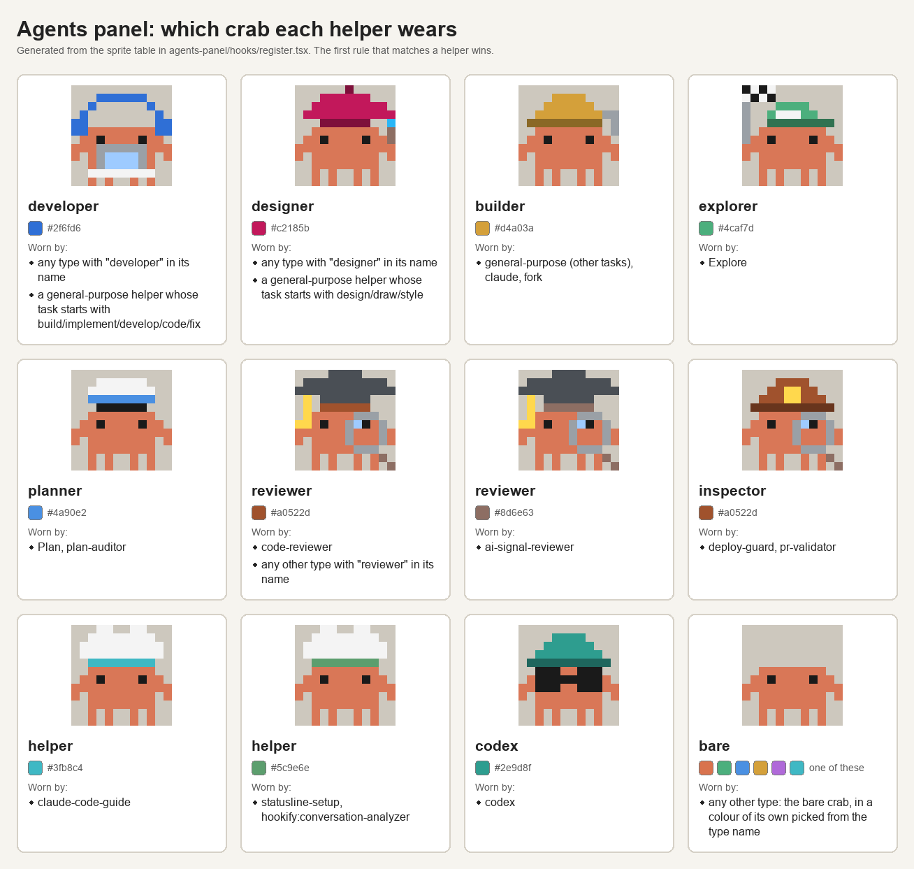
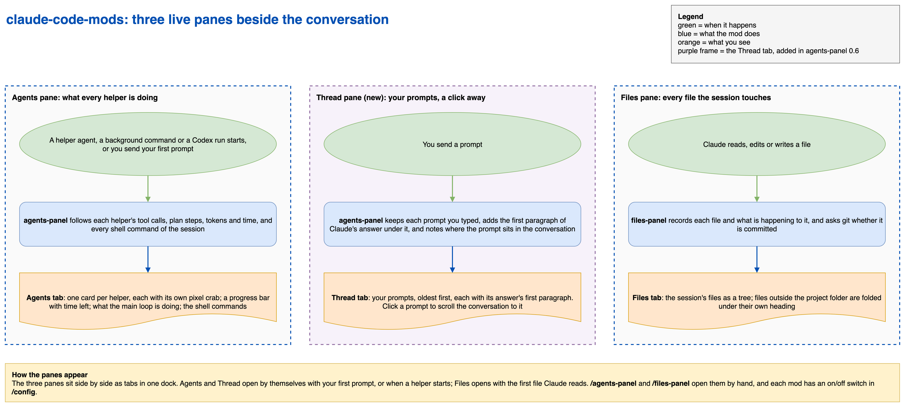

# Claude Code mods

Three mods for Claude Code that draw three live side panes (Agents, Thread and Files), showing what Claude and its helpers are doing while they work. A mod is a Claude Code plugin whose hooks draw on Claude's own screen, so these panes update by themselves as the session runs.

- **`agents-panel`**: a live Agents pane.
  - One card per helper agent: its task, what it is doing now, its recent actions, its plan steps, tokens, an approximate cost and its time. Each helper type wears its own pixel crab (a developer with headphones and a laptop, a reviewer in a graduation cap, a planner in a captain's hat, and so on).

    

    The map is generated from the mod's own sprite table in `agents-panel/hooks/register.tsx`.
  - A progress bar for the current batch of helpers at the top of the pane: tasks done, percent and time left. It can also be drawn above the prompt.
  - What the main loop is doing, and every shell command of the session, with background commands kept until they report back.
  - A card for each Codex run started through `codex_delegate.py` (from [claude-release-workflow](https://github.com/eranw2000/claude-release-workflow)): what it reviews, its model and effort, live tokens from its session log, time against its limit or against how long similar past runs took, and its end in words (finished, timed out, refused, and so on).
  - `/agents-panel` opens the pane.
- **`thread-panel`**: a live Thread pane, your conversation at a glance.
  - Each prompt you typed in this conversation, oldest first, with the first paragraph of Claude's answer under it, and how long ago each was.
  - A long prompt is folded; press to open it whole.
  - Click a prompt to scroll the conversation to it.
  - It opens with your first prompt, and `/thread-panel` opens it too.
- **`files-panel`**: a live Files pane.
  - Every file Claude reads, edits or writes this session, as a tree, with what is happening to each one and whether git has it committed.
  - Files outside the project folder are folded under their own heading.
  - `/files-panel` opens the pane.

The panes start over when you `/clear` or start a new conversation.



The diagram's source is [docs/mods-flow.drawio](docs/mods-flow.drawio).

## Install

Add this repository as a plugin marketplace, then install the mods you want:

```bash
claude plugin marketplace add https://github.com/eranw2000/claude-code-mods
claude plugin install agents-panel@claude-code-mods
claude plugin install files-panel@claude-code-mods
claude plugin install thread-panel@claude-code-mods
```

Restart Claude Code to load them. The panes open by themselves when there is something to show (Agents and Thread with your first prompt), or on `/agents-panel`, `/thread-panel` and `/files-panel`.

If you installed `agents-panel` before version 0.7.0, the Thread pane was part of it. It is now `thread-panel`: install it as above to keep the pane.

To update later:

```bash
claude plugin marketplace update claude-code-mods
claude plugin update agents-panel@claude-code-mods
claude plugin update files-panel@claude-code-mods
claude plugin update thread-panel@claude-code-mods
```

## Settings

Each mod has switches in `/config`:

- `agents-panel`
  - **Show the Agents pane** (on by default). Off: the pane never opens by itself.
  - **Show the progress bar above the prompt too** (off by default). The bar is always at the top of the Agents pane; on, it is also drawn above the prompt while helpers run.
- `files-panel`
  - **Show the files panel** (on by default). Off: nothing is tracked and the pane never opens.
- `thread-panel`
  - **Show the Thread pane** (on by default). Off: the pane never opens by itself and `/thread-panel` says it is off.

## What the mods run

The Codex card reads a run's own files (`.codex-runs/<run>/request.json`, `receipt.json` and `child-process.json` beside the run's `--out` file) and uses four read-only programs on macOS: `find`, `printenv`, `lsof` and `tail`. The Files pane asks `git` whether a file is committed. The Thread pane runs no programs. None of the mods writes files or changes anything in your repositories.

## License

MIT. See [LICENSE](LICENSE).
